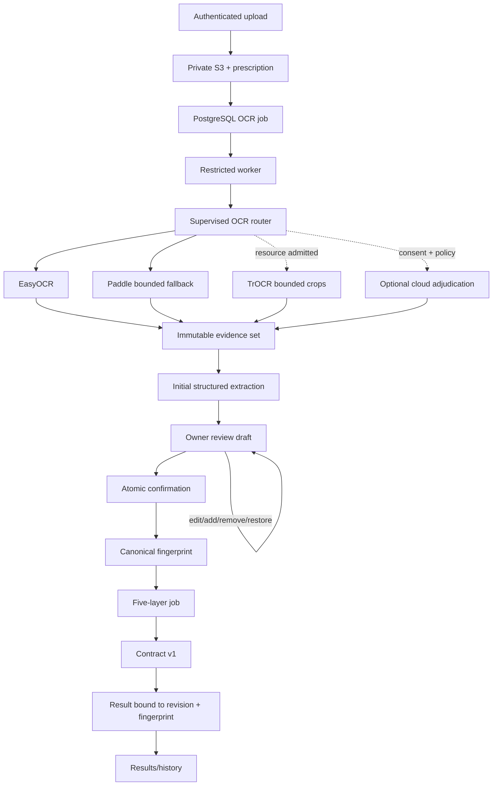
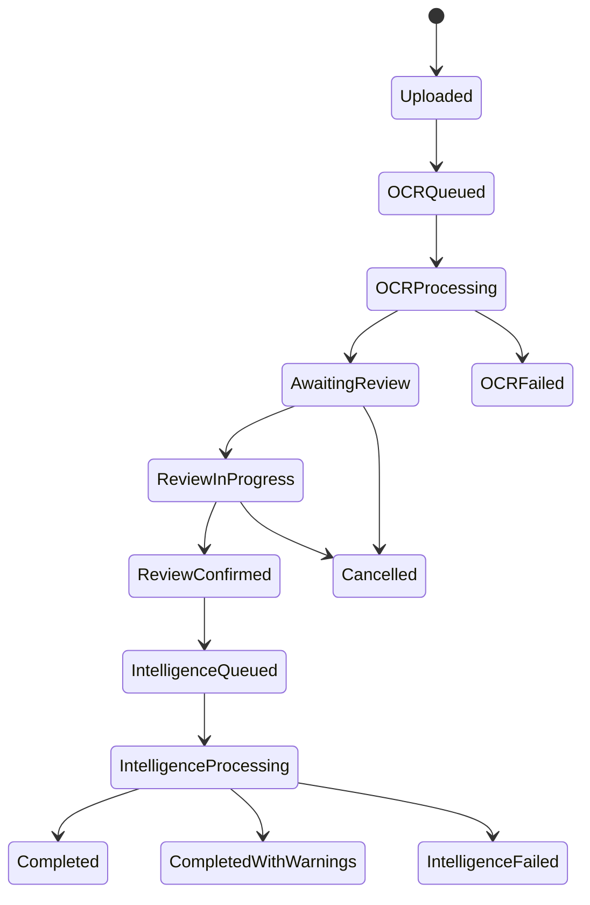

# MedDecode Target Architecture V3 — Proposed

**STATUS: PROPOSED — AWAITING OWNER APPROVAL**

This design authorizes no implementation, migration, hosted write, privilege change, cloud request, worker activation, or patient-data processing.

## Goals

Preserve the proven upload/S3/PostgreSQL-RPC worker/supervised OCR/five-layer/Contract v1 path; add auditable owner review; retain original evidence; prevent stale results; keep external OCR optional and disabled; scale with bounded workers before adding infrastructure.

## Target flow

## Authority boundaries

| Context | Authority | Invariant |
|---|---|---|
| Identity | Supabase Auth | never trust client owner IDs |
| Document | Express/S3/prescription repository | original object private and immutable |
| Jobs | PostgreSQL RPC + restricted worker | fenced and idempotent |
| OCR evidence | supervised Python runtime | immutable; conflicts preserved |
| Review | proposed application contract | corrections are revisions, never OCR rewrites |
| Intelligence | Layers 2-5 + Contract v1 | only confirmed canonical revision is current |
| Catalogue | restricted reader/RPC | suggestion is not equivalence |
| UI | React | observed, inferred, corrected and confirmed are distinct |

## Proposed additive data model

Names are provisional and require separately reviewed SQL.

- `prescription_ocr_evidence_sets`: immutable prescription/document hash, runtime/config version, bounded normalized provider evidence or private artifact reference.
- `prescription_review_revisions`: prescription-derived owner, revision number, base revision, lock version/ETag, `draft|confirmed|superseded`, evidence set, fingerprint, actor/timestamps.
- `prescription_review_medicines`: stable row/sequence, medicine fields, per-field provenance, original observed value, corrected value, tombstoned deletion.
- `prescription_review_events`: append-only add/change/remove/restore/confirm metadata, without unnecessary prescription text.
- intelligence job/result extensions: `confirmed_revision_id` and `input_fingerprint`; finalization must reject a stale revision/fingerprint.

Original OCR and old results remain immutable. A new confirmation supersedes rather than rewrites prior state.

## State separation

Document/presentation status, OCR job status, review revision status, and intelligence job status are separate concerns. Do not add all of them to one overloaded column.

## Proposed APIs

All derive owner from authentication and prescription linkage.

- `GET /api/v1/prescriptions/:id/review`
- `GET /api/v1/prescriptions/:id/review/revisions`
- `PATCH /api/v1/prescriptions/:id/review/draft` using `If-Match`/base revision and atomic row operations
- `POST /api/v1/prescriptions/:id/review/confirm` using idempotency key and expected lock version
- `GET /api/v1/prescriptions/:id/evidence` for bounded owner-safe metadata
- `POST /api/v1/prescriptions/:id/document-access` for short-lived preview or authenticated streaming

Batch patching keeps validation, ordering and concurrency atomic. Confirmation validates fields, creates the fingerprint, supersedes the prior confirmation, and enqueues at most one matching intelligence job.

## Invalidation rules

| Edit | Recompute/invalidate |
|---|---|
| Medicine name | catalogue match, ingredients, warnings, recommendations |
| Strength/unit | normalized dose, match and dose-related outputs |
| Dosage form | match and form/route warnings |
| Route | route-derived warnings/recommendations |
| Frequency/timing/duration | normalized instructions and schedule warnings |
| Add/remove row | associations, matching and aggregate warnings |

Corrections are not recommendations. Preliminary catalogue suggestions may assist review but must be labeled and revalidated after confirmation.

## OCR/evidence policy

Validate bytes/resources; use EasyOCR baseline; use Paddle only for bounded uncertain regions; use TrOCR only if adaptive routing and resource admission pass (currently disabled under 2 GiB); consider cloud only with explicit policy/consent. Never compare provider confidences as calibrated probabilities. Preserve material conflicts and withhold unresolved fields.

## Frontend target

Desktop: split private document/evidence preview and structured medicine editor. Mobile: stacked preview, medicine navigation and editor. Each field displays provenance and conflict—not a misleading aggregate score. Users may add/edit/remove/restore/reorder, then confirm a summarized revision. Results/history expose the revision and whether a result is current or superseded.

## Queue and scaling

PostgreSQL/RPC remains canonical. Use bounded concurrency, memory admission and separated supervised process classes for heavy providers. Scale worker count only after measuring database connections, leases, CPU/RAM and S3 throughput. A new queue requires a future ADR backed by measured failure, not preference.

## Optional cloud boundary

Any provider adapter requires explicit enablement, provider/region allowlists, per-request policy, timeout, size/page cap, cost budget, output cap and safe audit codes. It must not fetch arbitrary URLs, log prescription text, silently create cloud storage, or become an automatic low-confidence fallback.

## Rollout

1. Add disabled evidence/revision schema without altering current results.
2. Add owner APIs behind a disabled negotiated feature.
3. Add review UI behind the same contract.
4. Enable for a fictional allowlisted identity.
5. Verify conflicts, idempotency, stale fencing and rollback.
6. Accept genuine fictional PDF/JPEG/PNG flows and cross-user denial.
7. Expand only by separate approval.

Contract v1 remains unchanged and existing results/history stay readable. Rollback disables new V3 admission and preserves evidence/revisions; it does not delete history.

## Acceptance gates

- Reviewed schema/RLS/grants/rollback.
- Owner-only preview/evidence and cross-user denial.
- Concurrent edit, idempotent confirm and stale-finalization tests.
- No sensitive logs; immutable evidence.
- Genuine fictional PDF/JPEG/PNG review-to-result tests.
- Existing suites plus clean frontend lint.
- Separate approval before hosted activation.
