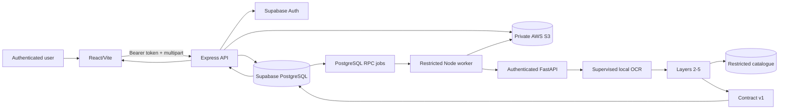

# MedDecode Master System Audit V3

**Audit date:** 2026-11-15  
**Repository:** `MedDecode-integration` (`integration/full-project`)  
**Scope:** Phase A.0 documentation and architecture freeze only  
**Authority:** No runtime, schema, hosted, credential, or cloud changes are authorized by this audit.

## Executive conclusion

MedDecode has a substantial working vertical slice: authenticated private uploads, S3 storage, PostgreSQL/RPC-backed jobs, a restricted worker, supervised local OCR, five-layer intelligence, Contract v1 validation, owner-scoped results/history, cabinet functions, and an official catalogue. It does not need a replacement architecture.

The material gap is a safe human-review boundary. OCR output currently proceeds directly into intelligence and persistence. Users can view confidence and warnings but cannot inspect source-linked evidence, correct structured fields, add or remove medicine rows, confirm a revision, or reliably invalidate stale downstream intelligence. V3 should close that gap with an additive revision model while preserving Contract v1 as the immutable machine-result contract.

The current queue is PostgreSQL/RPC-backed. No Redis, BullMQ, Celery, or replacement queue is present or justified for V3. Cloud OCR is not implemented and must remain optional, consent/policy gated, region constrained, cost bounded, and disabled by default.

## Evidence and limitations

This audit inspected current source, local reference SQL, tests, architecture notes, Phase 1/2 OCR reports, and official Google documentation. It did not query or mutate hosted infrastructure. Local SQL and deployment artifacts show intended code contracts, not proof of hosted state.

| Fresh check | Result |
|---|---:|
| Python regression suite | 384 passed |
| Backend tests | 503 passed |
| Backend typecheck/build | passed / passed |
| Frontend unit tests | 283 passed |
| Frontend production build | passed; 836.06 kB main chunk warning |
| Root launcher tests | 6 passed |
| Frontend lint | failed: 15 errors, 2 warnings |

The lint failure is a real acceptance gap, not grounds to discard other verified evidence. This phase did not modify frontend-owned code.

## Current system map

## Subsystem findings

### Frontend and user workflow

**Working/reusable:** Supabase-authenticated routes; upload, status polling, results, history, catalogue, comparison and cabinet surfaces; Contract v1 rendering; warnings/confidence; PDF/JPEG/PNG selection; negotiated automatic submission.

**Missing/incomplete:** no review/edit/confirm workflow; no immutable revision history, conflict detection, or stale-result indicator; no source-coordinate evidence reaching the UI; no owner-authorized original-document preview contract found; no add/remove/reorder/correct medicine UI. “Source evidence unavailable” is truthful but exposes the provenance gap.

### Express backend and APIs

**Working/reusable:** authenticated multipart validation; private `private/prescriptions/<uuid>/source.<ext>` keys; owner-scoped prescription creation; defensive storage reconciliation; `X-MedDecode-Auto-Submit: v1` negotiation; processing/cancellation/results/history routes; Contract v1 validation; bounded authenticated Python HTTP client.

**Missing/incomplete:** no review draft, patch, confirmation, revision-history, or evidence APIs; no optimistic-concurrency contract; no canonical fingerprint binding results to the confirmed input; no uniform invalidation/recompute contract after correction.

### Database and authorization

**Working/reusable:** owner-linked prescriptions, jobs, results, extracted medicines, warnings, cabinet, audit, and analytics in the local reference schema; RLS-oriented owner isolation; restricted worker RPCs; result fencing/idempotency.

**Missing/incomplete:** no review revision or corrected-field provenance model; no result-to-confirmed-revision/fingerprint linkage; no optimistic version/ETag; lifecycle concerns would be overloaded if added to the current single status model. Hosted parity was deliberately not asserted.

### Worker, queue, and runtime

The native Node worker uses PostgreSQL RPC claims, leases, heartbeats, fencing, completion/failure, cancellation, and recovery. Dedicated restricted identities, scoped authorization, S3 isolation, and controlled single-attempt mode exist. The root launcher keeps processing disabled by default.

**Architecture correction:** the system does not use Redis/BullMQ. PostgreSQL/RPC is canonical and should remain so until measured load proves a limitation. A second queue would add synchronization and security risk without solving OCR memory pressure.

### Formats and image preparation

| Capability | Status | Limitation |
|---|---|---|
| PDF | Supported | genuine fictional evidence exists |
| Multi-page PDF | Implemented, not fully accepted | bounded, but broad genuine acceptance incomplete |
| Searchable PDF native text | Not implemented | pages are rendered |
| Scanned PDF | Supported | rendered to OCR images |
| JPEG / PNG | Supported | signatures, dimensions and decompression guarded |
| TIFF/BMP/WebP/HEIC | Unsupported end to end | must not be advertised |
| EXIF orientation | Supported | normalized before OCR |
| Deskew/perspective/shadow removal | Partial | quality diagnostics exist; no complete correction pipeline |

Safety controls cover bytes, PDF pages, dimensions, per-page/aggregate pixels, duration, output size, temporary files, and supervised process-tree memory. Corrupt files and decompression bombs fail closed.

### OCR and evidence

- EasyOCR: default; genuine inference verified.
- PaddleOCR: bounded adaptive fallback; genuine inference verified.
- TrOCR: genuine isolated inference verified, but the measured three-provider tree peak (about 3.0 GiB) exceeds the 2 GiB request budget. Disabled/fail-closed is correct.

The internal hybrid representation retains provider, polygon, raw confidence, reconciled regions, failures, and disagreement warnings. Clinically material conflicts are withheld downstream. Contract v1 and current persistence/UI do not carry the full evidence graph, preventing source highlighting and safe human adjudication.

Provider confidence values are not calibrated probabilities. They must not be averaged or majority-voted as equivalent. Medicine name, decimal, strength, unit, route, and frequency conflicts must remain explicit alternatives or withheld values.

### Five-layer intelligence

The pipeline is integrated and covered by the 384-test suite, preserves warnings into Contract v1, uses restricted catalogue access, and handles unmatched fictional medicines conservatively. Indian abbreviations and multi-medicine cases have substantial tests, but the dedicated Phase 2.6A completion report is absent. Multi-medicine association is therefore **PARTIAL / implemented but not globally accepted**. Layer 5 rankings must not be presented as therapeutic equivalence.

### Security and privacy

Preserve Supabase Auth, owner scoping, private S3, separate least-privilege identities, TLS, parameterized SQL, RPC-only worker writes, internal FastAPI bearer authentication, supervised resource limits, disabled cloud OCR, and disabled worker defaults.

V3 needs immutable evidence plus attributable corrections, owner-only short-lived document preview, cloud-processing policy/consent/region/cost controls, revision concurrency, stale-result fencing, and identifier-only logs without prescription text/images.

## Google OCR suitability assessment

No Google request was made. This is a design evaluation only.

Cloud Vision `DOCUMENT_TEXT_DETECTION` is optimized for dense text and handwriting with page/block/paragraph/word/symbol structure. Its asynchronous PDF/TIFF flow uses Cloud Storage input/output, adding a new data lifecycle to the current S3-only design. See [Vision features](https://docs.cloud.google.com/vision/docs/features-list), [PDF/TIFF OCR](https://docs.cloud.google.com/vision/docs/pdf), and [pricing](https://cloud.google.com/vision/pricing).

Document AI Enterprise OCR provides printed/handwritten OCR, layout signals, deskew, quality scores, native-text controls, and broader formats. It also introduces processor provisioning, regional policy, cost, and an evidence-normalization contract. See [Enterprise OCR](https://docs.cloud.google.com/document-ai/docs/enterprise-document-ocr), [file types](https://docs.cloud.google.com/document-ai/docs/file-types), [limits](https://docs.cloud.google.com/document-ai/limits), [regions](https://docs.cloud.google.com/document-ai/docs/regions), [security](https://docs.cloud.google.com/document-ai/docs/security), and [pricing](https://cloud.google.com/products/document-ai/pricing).

**Decision:** Google OCR may be an optional adjudication provider, not a replacement baseline. It requires unresolved material conflict, approved consent/policy, region/retention/credentials/cost/timeout controls, non-destructive evidence normalization, and graceful failure. It remains disabled by default. Low confidence alone is not consent or proof of necessity.

## Top findings

1. Missing human review/revision is the largest gap, not missing OCR engines.
2. Contract v1 should remain the immutable machine-result boundary.
3. Internal OCR evidence is richer than persisted/UI evidence.
4. PostgreSQL/RPC is the real queue; Redis/BullMQ is unjustified duplication.
5. Corrections need provenance, optimistic concurrency, and invalidation.
6. TrOCR exceeds the approved memory budget; disabled is correct.
7. PDF/JPEG/PNG are the only truthful end-to-end format claims.
8. Multi-medicine association is implemented but incompletely accepted.
9. Test/build evidence is strong; frontend lint is unresolved.
10. Existing status docs are stale and should be superseded only after approval.

## Risk register

| Risk | Severity | Proposed control |
|---|---|---|
| Incorrect OCR acted on without confirmation | Critical | mandatory review/confirm boundary |
| Stale async result overwrites correction | Critical | revision ID + fingerprint + fenced finalization |
| Cross-user correction/evidence access | Critical | token-derived owner + RLS |
| OCR conflict silently collapsed | High | preserve alternatives; withhold material fields |
| TrOCR memory exhaustion | High | remain disabled under 2 GiB |
| External OCR privacy/residency breach | High | disabled default; explicit policy/consent/region |
| Queue duplication | High | freeze PostgreSQL/RPC for V3 |
| Unsupported formats advertised | Medium | explicit capability allowlist |
| Hosted/local schema drift | High | preflight + independent verification |
| Frontend quality regression | Medium | clean lint before acceptance |

## Status

`CURRENT_VERTICAL_SLICE: VERIFIED_WITH_LIMITATIONS`  
`HUMAN_REVIEW_WORKFLOW: NOT_IMPLEMENTED`  
`OCR_EVIDENCE_PERSISTENCE: PARTIAL`  
`MULTI_MEDICINE_ASSOCIATION: PARTIAL`  
`THREE_PROVIDER_RUNTIME: BLOCKED_BY_MEMORY_BUDGET`  
`CLOUD_OCR: NOT_IMPLEMENTED_DISABLED_BY_DESIGN`  
`ARCHITECTURE_REPLACEMENT_REQUIRED: NO`
